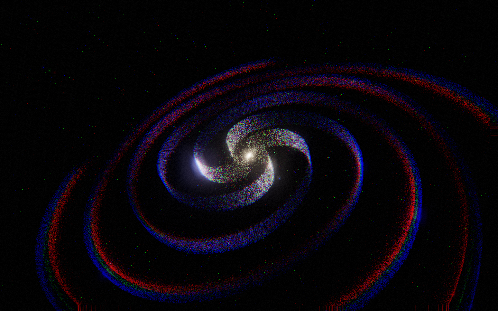
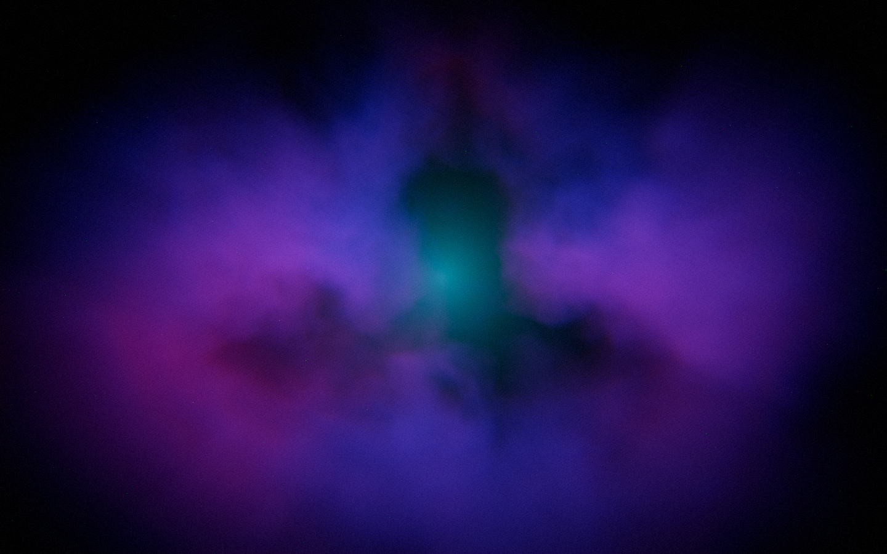
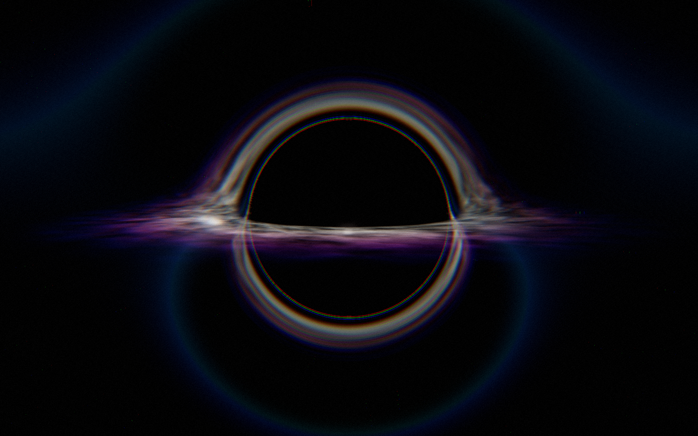
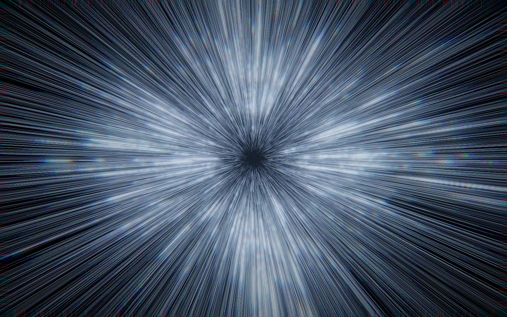
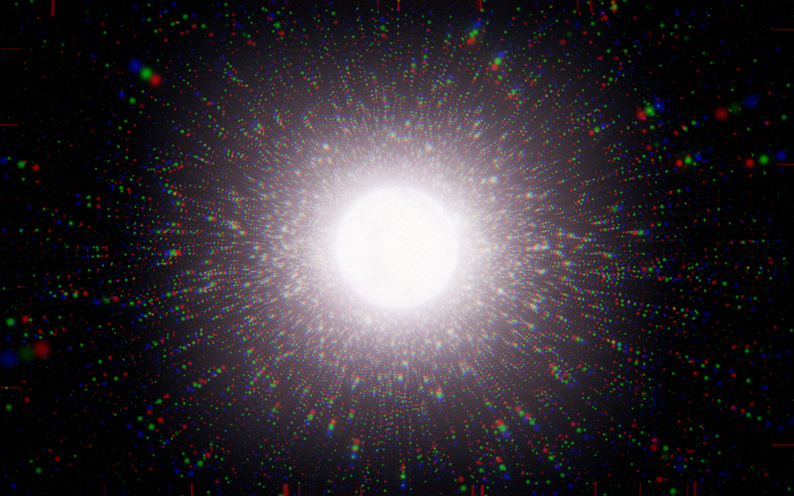
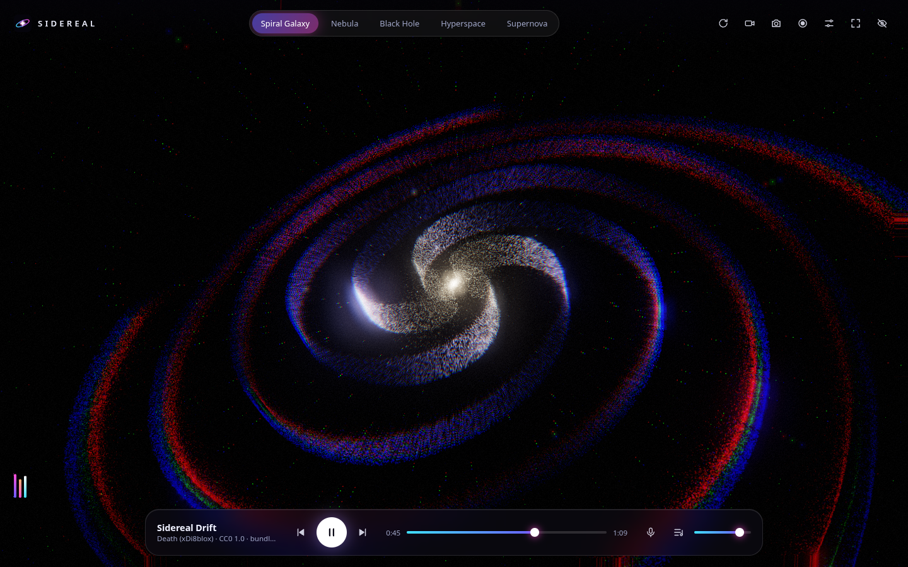
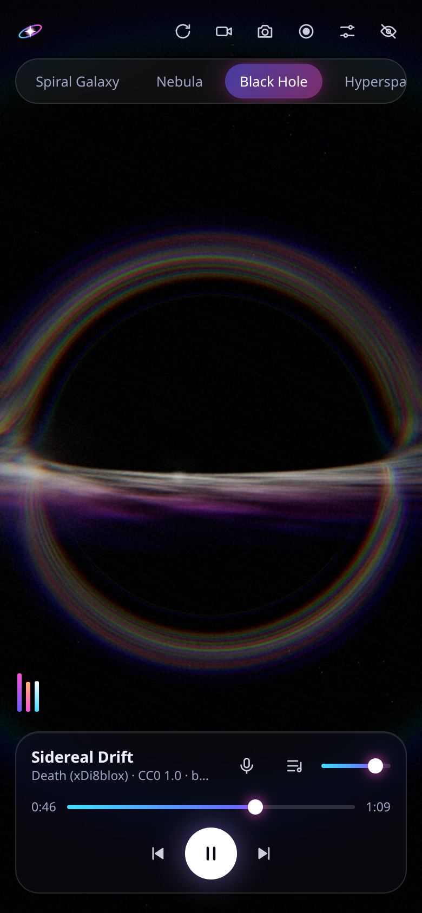

# ✦ Sidereal: a cosmic music visualizer

**Sidereal turns any song into a journey through deep space.** It's a real-time 3D music visualizer: a spiral galaxy of 100k+ GPU particles pulsing with the bass, raymarched nebulae breathing with the mids, a gravitationally-lensed black hole, hyperspace jumps on the drop and supernova shells fired on every beat.

**Live → https://xdi8blox.github.io/sidereal/**

It works the moment you open it with the bundled demo track. You can also drop in your own music or use the microphone.

## Screenshots

| Spiral Galaxy | Nebula |
|---|---|
|  |  |
| **Black Hole** | **Hyperspace** |
|  |  |
| **Supernova** | **UI (desktop)** |
|  |  |



## Features

- **Five shader scenes** with smooth crossfades and an auto-cycle option (drops can trigger a hyperspace jump):
  - **Spiral Galaxy**: 60k–500k particles animated entirely in a vertex shader; differential rotation, bass waves travelling along the arms
  - **Nebula**: volumetric raymarched fBm clouds with domain warping; density and colour react to mids, sparkles to treble
  - **Black Hole**: per-pixel ray bending around a singularity, a turbulent accretion disk with Doppler beaming, an Einstein ring and a lensed starfield
  - **Hyperspace**: streaking star lines whose speed and stretch follow energy and drops
  - **Supernova**: a turbulent star plus recycled GPU burst shells launched on detected beats
- **Audio**: Web Audio `AnalyserNode`; bass/mid/treble bands with asymmetric attack/release smoothing; spectral-flux onset detection with an adaptive threshold; "drop" detection (short-term vs long-term energy)
- **Inputs**: bundled demo track, drag-and-drop or open local files (playlist), microphone, synthetic test signal (`?synth`)
- **Playback**: play/pause, prev/next, seek bar, volume, playlist
- **Post-processing**: Unreal bloom, ACES tone mapping, beat-driven chromatic aberration, film grain, vignette
- **Camera**: cinematic auto-orbit with beat shake, or free orbit/zoom (mouse, touch, pinch)
- **Capture**: PNG screenshots, and video clips via `canvas.captureStream` + `MediaRecorder` (WebM/MP4 with audio)
- **Settings** (saved locally): sensitivity, bloom, 5 palettes, particle count, quality tier (auto-detects mobile), cycle time, FX toggle
- **Performance**: quality tiers scale raymarch steps, particle counts and pixel ratio; dynamic resolution backs off below ~42 fps
- **UI**: glassy minimal interface that auto-hides while playing; hide-UI mode; fullscreen; responsive mobile layout; swipe to change scenes

### Keyboard

`Space` play/pause · `1–5` scenes · `←/→` seek · `↑/↓` volume · `N/P` next/prev · `A` auto-cycle · `C` camera mode · `M` mic · `F` fullscreen · `H` hide UI · `S` screenshot · `R` record · `Esc` close panels

### URL parameters

`?scene=blackhole` · `&palette=Solar` · `&quality=low|medium|high` · `&ui=0` · `&auto=0` · `&synth` · `&autoplay&seek=38`

## Run locally

```bash
npm install
npm run dev          # http://localhost:5173
npm run build        # type-check + production build
npm run track        # regenerate the demo track WAV (/tmp/track.wav; encode with ffmpeg)
URL=http://localhost:4173/ npm run shots   # Playwright screenshots (set CHROME=/path/to/chrome if needed)
```

## Tech

Vite · TypeScript (strict) · Three.js (custom `ShaderMaterial`s, EffectComposer) · GLSL · Web Audio API · MediaRecorder · Playwright · GitHub Actions → Pages.

## Credits

- **Demo track "Sidereal Drift"** (124 BPM, 70 s) was synthesised from scratch by `scripts/make-track.mjs` (no samples). © Death (xDi8blox), dedicated to the public domain under [CC0 1.0](https://creativecommons.org/publicdomain/zero/1.0/).
- Built on [three.js](https://threejs.org) (MIT). Noise functions follow well-known public-domain value-noise/fBm patterns.

## License

MIT © Death (xDi8blox). See [LICENSE](LICENSE).
